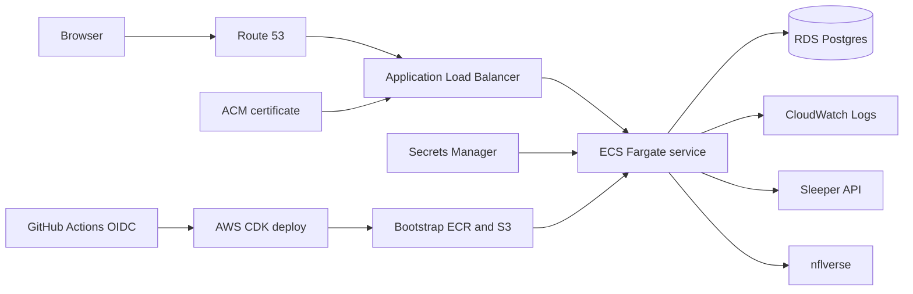

# AWS architecture baseline

Use this document as the starting point for AWS-hosted projects in this
repository. It sets defaults, not a requirement to put every workload in
containers. Choose the smallest managed service that matches how the program
runs, keep the infrastructure in code, and make production changes repeatable.

## Project rules

1. Define cloud resources in AWS CDK and review the synthesized change before
   deployment.
2. Keep development, staging, and production in separate AWS accounts when a
   project reaches real users or valuable data.
3. Use GitHub OIDC and short-lived AWS credentials. Do not store AWS access
   keys in repository secrets.
4. Deploy immutable artifacts. A commit produces a content-addressed container
   image or versioned function package, and infrastructure points to that
   version.
5. Put credentials in Secrets Manager or Parameter Store, never in source,
   images, task definitions, or workflow output.
6. Keep databases private, encrypted, backed up, and reachable only by the
   workload security group.
7. Send application logs and service metrics to CloudWatch. Add alarms for
   availability, errors, saturation, and storage before calling a service
   production-ready.
8. Tag every resource with project, environment, and managed-by values. Add an
   owner tag when the organization has a stable team identifier. Add an AWS
   Budget and cost alerts in every account.
9. Prefer one clear deployment path. Local operators and CI should run the same
   CDK stack with different credentials.
10. Record recovery steps and test restoration before the data becomes
    irreplaceable.

## Choosing a runtime

| Workload | Default AWS services | Use it when |
|---|---|---|
| Static site | S3 and CloudFront | The build produces files and needs no server process |
| Request-driven API or webhook | API Gateway and Lambda | Requests are short, stateless, and can tolerate cold starts |
| Scheduled or event work | EventBridge, Lambda, and SQS | Jobs are bounded and retryable |
| Long-running web application | ECS Fargate and ALB | The app is a container, keeps a server process, or needs predictable runtime behavior |
| Relational data | RDS Postgres or Aurora | Transactions and relational queries matter |
| Key/value or event state | DynamoDB | Access patterns are known and relational joins are unnecessary |
| Files and generated artifacts | S3 | Objects should be durable and independently addressable |
| User identity | Cognito or the application's tested account layer | Choose one source of identity and enforce tenant scope at every data boundary |

Do not begin with EKS unless Kubernetes is already an operational requirement.
Fargate and Lambda remove cluster administration and fit most small and medium
projects.

## Fantasy Copilot deployment

The ALB and tasks run in public subnets to avoid a NAT Gateway's fixed monthly
cost. The tasks receive public IPs for outbound Sleeper and nflverse requests,
but their security group accepts application traffic only from the ALB. RDS
runs in isolated subnets and accepts Postgres traffic only from the task
security group.

CDK builds the ARM64 Docker image, publishes it under a content hash in the
bootstrap ECR repository, and creates a new ECS task definition. This lets the
first deployment and every update use the same command and makes a rollback
refer to a known image.

## Environments

Start with a single small deployment for development or a trusted league. Add
staging before outside users depend on the service.

| Concern | Development | Production |
|---|---|---|
| Account | Sandbox account | Dedicated production account |
| Domain | ALB test URL or development subdomain | Route 53 domain with ACM TLS |
| Database | Single-AZ RDS, 7-day backups | Multi-AZ RDS, longer retention, deletion protection |
| Deploy | Local CDK | Manual GitHub production workflow with environment approval |
| Schema | `prisma db push` while schema is disposable | Committed migrations run once before service rollout |
| Monitoring | Logs and health endpoint | Alarms, dashboard, notification destination, and synthetic check |
| Recovery | Recreate stack | Restore rehearsal with documented recovery time and recovery point goals |

Fantasy Copilot currently supports one operator or trusted league per
deployment. A shared service for unrelated customers first needs tenant-scoped
authorization, queries, caches, jobs, and audit records. Infrastructure alone
cannot create that isolation.

## Production gate

Before promoting any project to production:

- CDK synth and diff succeed from a clean checkout.
- Automated tests and the production build pass.
- HTTPS is enabled and the HTTP listener redirects to HTTPS.
- The GitHub role trust policy names the exact repository and protected
  environment.
- Database restore steps have been exercised.
- CloudWatch alarms have a tested notification destination.
- A budget alert and resource tags are present.
- Secrets have rotation or replacement instructions.
- The service has a rollback procedure using the preceding artifact.
- Destructive CDK changes are reviewed separately from application changes.

The deploy commands and current Fantasy Copilot limits are in
[infra/README.md](./infra/README.md).
